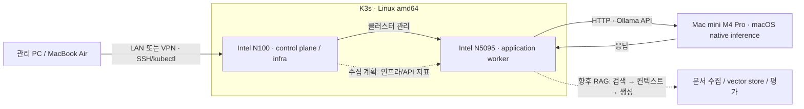

# Hybrid-K3s-Cluster v2 — Local AI Engineering Platform

Mac mini M4 Pro의 로컬 AI 추론과 Intel N100·N5095의 K3s 서비스 운영을 연결하는 홈랩 기반 AI 엔지니어링 포트폴리오입니다. 하드웨어별 강점을 활용해 모델 서빙, API 통합, 관측, 향후 RAG 평가까지 재현 가능한 기록으로 발전시킵니다.

> **상태:** v2 목표 아키텍처와 운영 가이드입니다. 이 변경은 하드웨어 배포를 수행하지 않습니다. 기존 v1 구축 기록과 v2 계획을 구분하며, 실측 성능·가용성·RAG 구현 완료를 주장하지 않습니다.

## 아키텍처

| 장비 | 역할 | 배치 원칙 |
|---|---|---|
| Mac mini M4 Pro | 로컬 LLM 추론, 향후 embedding/reranker | macOS 네이티브 Ollama 우선. MLX는 후속 비교 실험 |
| Intel N100 | K3s server, control plane, ingress 및 관측 인프라 | 인프라 자원 예산 확보. 단일 control plane |
| Intel N5095 | K3s agent, API/backend 및 향후 RAG worker | 앱에 nodeSelector와 requests/limits 지정 |
| 관리 PC / MacBook Air | 개발, SSH, kubectl | LAN/VPN으로 관리 |
| iMac/Lima · MacBook Pro 2014 | v1 학습·운영 이력 | [legacy 보관](legacy/README.md), v2에서는 제외 |

Mac mini는 K3s worker로 가입시키지 않습니다. 모델 서빙과 클러스터 수명주기를 분리합니다. N100 장애 시 control plane이 중단되며, Mac mini 장애 시 생성 API가 불가합니다. 이 구성은 HA 구성이 아닙니다. 메모리·스토리지 실물 사양과 추론 가능 모델 크기는 배포 시 확인합니다.

## 문서 및 진행 순서

1. [설계 결정과 네트워크](docs/v2/architecture.md)
2. [N100 / N5095 K3s 구성](docs/v2/k3s-nodes.md)
3. [Mac mini AI 서버](docs/v2/mac-mini-ai-server.md)
4. [K3s → 로컬 LLM 통합 및 검증](docs/v2/local-llm-integration.md)
5. [모니터링과 장애 대응](docs/v2/monitoring.md)
6. [향후 RAG 플랫폼 로드맵](docs/v2/rag-platform.md)
7. [v1 → v2 전환과 롤백](docs/v2/migration.md)

기존 Linux 설치 기초는 [N100](docs/01-n100-서버-셋업.md), [N5095](docs/08-n5095-워커-노드-추가.md)를 참고하되 v2 네트워크·노드 역할은 위 가이드를 따릅니다.

## 포트폴리오에서 보여줄 근거

| 역량 | 이 저장소의 산출물 | 후속 검증 자료 |
|---|---|---|
| 시스템 설계 | 역할 분리와 장애 경계, 전환 가이드 | 실제 노드/버전 목록, 의사결정 변경 기록 |
| 모델 서빙 | Mac mini 설정, Service + EndpointSlice 예제 | 모델·양자화·컨텍스트·동시성별 TTFT/처리량/메모리 |
| 서비스 운영 | 클러스터 호출 절차, timeout/실패 처리 설계 | 부하 테스트와 장애 복구 기록 |
| 관측 가능성 | 지표·알림·운영 절차 설계 | 대시보드와 실제 알림 증거 |
| RAG 품질 | 수집·검색·생성·평가 로드맵 | 고정 평가셋, 검색/인용 품질 비교 |

## 실행 범위

활성 예제는 `manifests/ollama/ollama-service.yaml`입니다. placeholder를 실제 Mac mini LAN IP로 바꾼 뒤 통합 문서 순서대로 적용합니다. `manifests/` 전체를 재귀 적용하지 마세요. nginx와 node-exporter는 기존 개별 실습 예제이며 완성된 AI/RAG 배포 스택이 아닙니다.

`legacy/`에는 전환 전 README, 전체 문서, 관련 스크립트와 매니페스트가 보존되어 있습니다. 기존 경로의 구형 장비 문서는 보관 위치로 안내합니다. 기존 자동화에는 v1 네트워크 가정이 있으므로 v2 무인 설치 절차로 사용하지 않습니다.
