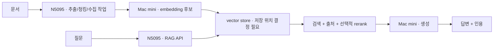

# 향후 RAG 플랫폼 로드맵

상태: **설계 / 미구현**. 벡터 DB, ingestion worker, backend와 평가 파이프라인은 아직 제공하지 않습니다.

## 증분 구현

| 단계 | 산출물 | 완료 기준 |
|---|---|---|
| 1. 생성 API | backend, 설정, timeout, health probe | K3s에서 생성 및 장애 시험 통과 |
| 2. 작은 문서셋 | 추출/청킹, 문서 hash/version, 재수집 | 같은 입력 중복 적재 방지, 삭제 전파 |
| 3. 검색 | embedding 모델 고정, vector store/PVC | 정답 문서 검색 평가와 복원 시험 |
| 4. 답변 | 컨텍스트 예산, 인용, 모름 처리 | 근거 없는 질문 거절 및 인용 일치 확인 |
| 5. 평가/관측 | 고정 질문셋, 실행 기록, 대시보드 | baseline 대비 품질·지연 비교 재현 |

N5095 메모리와 디스크를 실측한 뒤 vector store 제품과 배치 위치를 결정합니다. embedding 모델 변경은 차원·인덱스 재생성을 포함합니다. 생성·embedding·reranking이 한 Mac mini 메모리를 공유하므로 동시성을 제한하고 배치 수집은 온라인 요청과 시간을 분리합니다.

## 평가 설계

작은 고정 질문셋과 정답 문서/근거 구간을 먼저 만듭니다. train/tuning 질문과 평가 질문을 분리하고 retrieval recall@k, 인용 정확성, 근거 충실도, 답변 가능/불가 판정, p95 전체 지연을 비교합니다. 모델 digest·청크 크기·overlap·top-k·reranker·prompt 버전과 하드웨어 조건을 기록합니다. 임의의 성능 수치를 README에 넣지 않습니다.

문서는 신뢰할 수 없는 입력으로 취급하고 검색된 텍스트의 지시를 시스템 명령으로 실행하지 않습니다. 사용자별 접근권한을 검색 전에 적용하고 원본/인덱스/백업의 삭제 정책을 함께 설계합니다. 민감 문서와 prompt 원문은 기본 로그에서 제외합니다.
